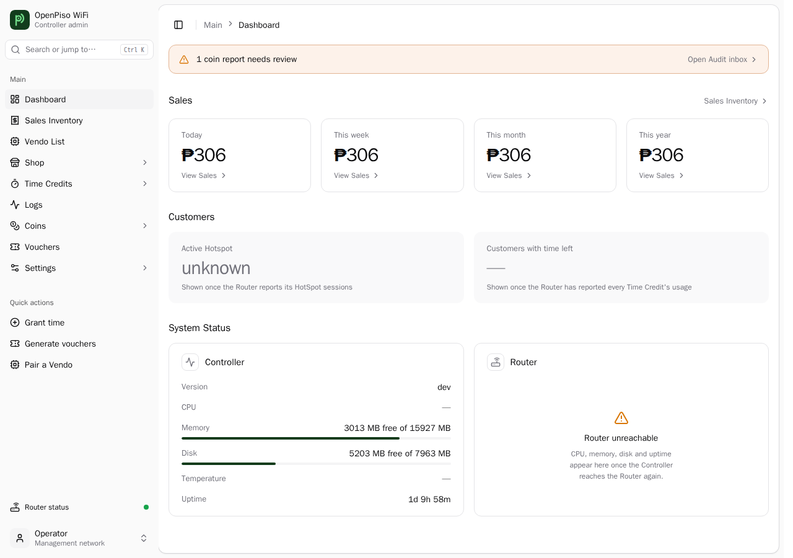

# OpenPiso WiFi

Sell WiFi time by Voucher on your MikroTik, today. Coin Vendos are coming.

OpenPiso WiFi turns a small Linux board into the **Controller** for your **Shop** (the place you sell WiFi time). It prints **Vouchers** (single-use codes worth a fixed amount of time), keeps the record of the time each customer bought, and tells your MikroTik **Router** who may go online.

> **Early release.** OpenPiso WiFi is new and still changing; if something does not work, please [tell us on GitHub Issues](https://github.com/H3atman/openpiso-wifi/issues).



## What you need

- A small Linux board for the Controller: an Orange Pi Zero on Armbian (tested), a Raspberry Pi on Raspberry Pi OS Lite, or any arm64 or amd64 computer that runs Linux with systemd.
- A MikroTik on RouterOS v7 (tested) that already has a working HotSpot server, with `www-ssl` turned on and a certificate.
- A Windows PC on the same network, to set up the board.

The full list is in [What you need](docs/guide/what-you-need.md).

## Quick start

1. **Prepare the board.** Write Armbian or Raspberry Pi OS Lite to a microSD card, start the board on your MikroTik's LAN, make its DHCP lease static, and connect to it from PowerShell with `ssh root@192.168.10.2` (your board's address).
2. **Install the Controller.** On the board, run the commands below. Use the file for your board (`openpiso-linux-armv7`, `openpiso-linux-arm64` or `openpiso-linux-amd64`), and change the two addresses to your board's address and your network. The installer asks you for an admin password.

   ```sh
   base=https://github.com/H3atman/openpiso-wifi/releases/latest/download
   curl -fLO "$base/openpiso-linux-armv7"
   curl -fLO "$base/openpiso-install.tar.gz"
   tar -xzf openpiso-install.tar.gz
   cd install
   sudo sh install.sh --binary ../openpiso-linux-armv7 \
     --portal-url http://192.168.10.2 \
     --admin-network 192.168.10.0/24
   ```

3. **Log in.** On your PC, open `http://192.168.10.2/admin/login` and log in with the admin password.
4. **Connect the Router.** Give the Controller your MikroTik's address and admin login, and confirm its certificate. See [Connect the Router](docs/guide/connect-the-router.md).
5. **Sell your first Voucher.** Generate Vouchers, print them, and redeem one on a phone. See [Sell your first Voucher](docs/guide/sell-your-first-voucher.md).

The [Guide](docs/guide/what-you-need.md) explains each step in full, starting with [Install the Controller](docs/guide/install-the-controller.md) for steps 1 to 3. It is also on the Website at [h3atman.github.io/openpiso-wifi](https://h3atman.github.io/openpiso-wifi/).

## Contributing

To work on the code, see [CONTRIBUTING.md](CONTRIBUTING.md). The technical reference for the Controller is [controller/README.md](controller/README.md).

## License

OpenPiso WiFi is licensed under the GNU General Public License v3.0; see
[LICENSE](LICENSE).
