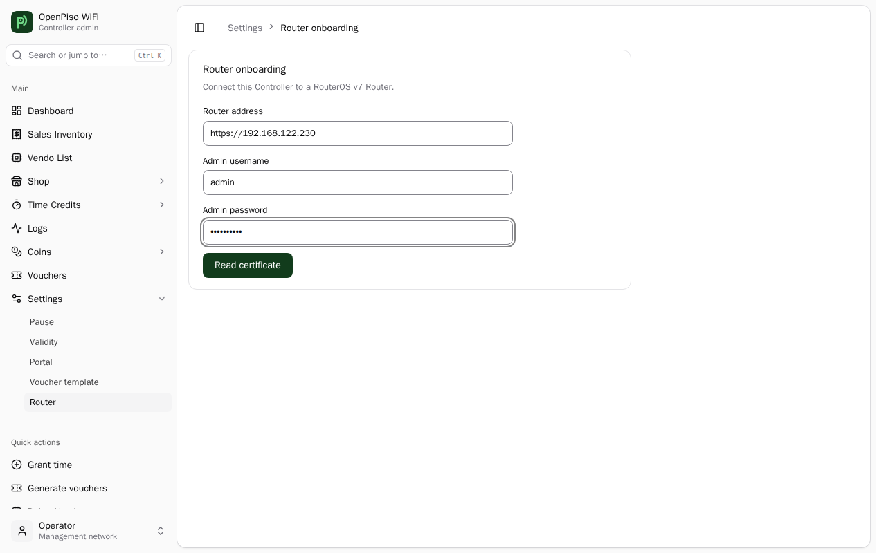
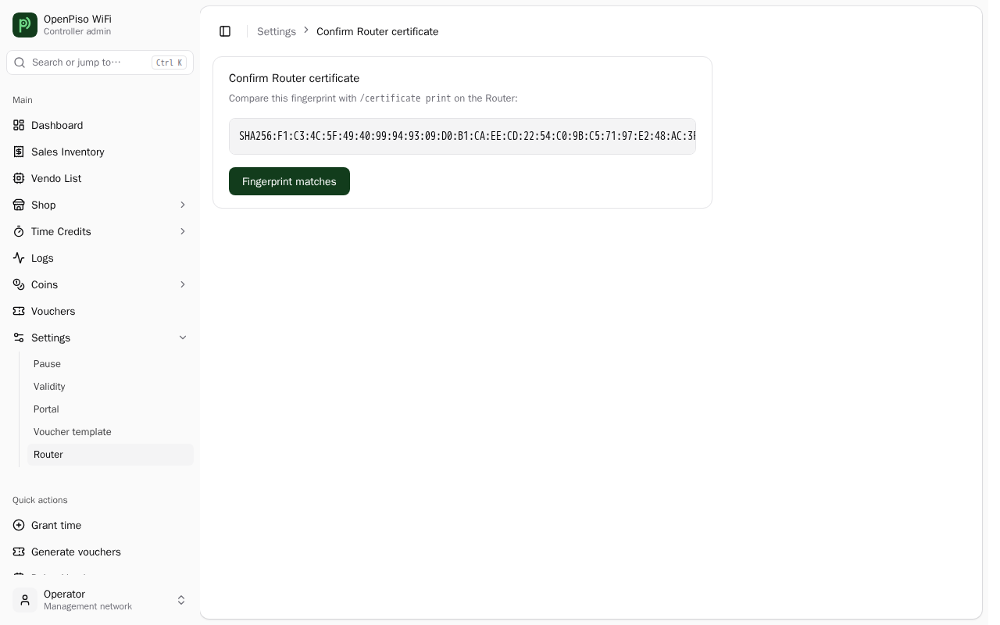

# Connect the Router

In this step you connect the Controller to your MikroTik **Router**, then choose which **HotSpot server** (one captive network on the Router: the interface customers join, with its own login page and address range) sends customers to the Portal. You do it once, from the admin panel. Before you start, check the Router list in [What you need](what-you-need.md#your-router-before-you-start).

It takes about 10 minutes.

## 1. Enter the Router's details

1. In the admin panel, open **Settings › Router setup**.
2. Under **Connect a Router**, fill in:
   - **Router address**: `https://` followed by the Router's address, for example `https://192.168.10.1`. Use the same address your `www-ssl` certificate names, and nothing after it.
   - **Admin username** and **Admin password**: your MikroTik admin login.
3. Select **Read certificate**.



The Controller now reads only the Router's certificate. It does not send your password yet.

## 2. Check the fingerprint

The page **Confirm Router certificate** shows a fingerprint: a long line of letters and numbers that belongs to the Router's certificate, like `SHA256:4F:2A:…`. Checking it proves the Controller is talking to your Router and not to another device pretending to be it.

1. On the Router, open the terminal (**Terminal** in WebFig, **New Terminal** in Winbox) and type:

   ```
   /certificate print detail
   ```

2. Find the certificate `www-ssl` uses (`openpiso-router` if you made it with [What you need](what-you-need.md#make-a-certificate-for-www-ssl)) and its `fingerprint`. RouterOS shows it in small letters and without the `SHA256:` and the colons. The letters and numbers must be the same as on the admin panel, in the same order.
3. If they match, select **Fingerprint matches**. If they do not, stop: check the Router address and try again.



Nothing changes on the Router before you select **Fingerprint matches**. From then on, the Controller trusts only this certificate.

The Controller then saves a backup of the Router, named `openpiso-` followed by the date and time, and adds its own `openpiso-controller` user. It forgets your admin password and changes no HotSpot server yet. You are back on **Router setup**, which shows the Router's address and RouterOS version.

## 3. Choose a start

Router setup offers three ways to start. Pick the one that fits your Router. The Controller changes only the HotSpot servers you **Adopt** (put under its management); it leaves every other server alone.

### Use existing

For a Router that already has a HotSpot server you want to use.

1. Under **Use existing**, tick the servers you want and select **Review changes**.
2. The next page names the two changes on each server: its login page moves to the Controller's `openpiso` folder, which sends customers to the Portal, and its login method becomes HTTP PAP only. It also shows what each server has today.
3. Select **Adopt**.

If two servers share one server profile, tick both, or give one of them its own server profile on the Router first. If you later point a server you did not Adopt at an Adopted server's profile, the Controller stops changing that profile and the checklist shows the steps instead.

### Add alongside

For a Router where something else keeps running, such as another vending system on its own HotSpot server. The Controller creates a new HotSpot server next to the ones in use and Adopts it. It does not change the servers already there.

- **On a new VLAN** (recommended): pick the parent interface, the VLAN ID and the address range. The Controller suggests the interface under your HotSpot server, the lowest VLAN ID from 2 that is free on it, and a private range that overlaps nothing on the Router. Select **Create VLAN and Adopt**. Then carry that VLAN to an SSID on your access point, and tag it on the switch ports between the access point and the Router; Router setup reminds you until a customer reaches the Portal from it.
- **On an interface with no HotSpot server**: pick the interface and address range, and select **Create and Adopt**.

The Controller adds the VLAN interface (for a new VLAN), its address, an address pool, a DHCP server, a server profile, the HotSpot server, and a NAT rule so its customers reach the Portal. If one of your own objects already has the name the Controller would use, such as a pool or server profile called `openpiso-ether3`, it adds nothing and names that object; rename it on the Router or place the server elsewhere. If creating fails partway, or the page never answers, send the same form again: the Controller finishes and Adopts the server it made.

If the parent is a bridge with VLAN filtering on, the Controller adds nothing: a wrong bridge VLAN entry can cut you off from the Router. The page shows the commands to add the VLAN yourself. Run them, then use **On an interface with no HotSpot server** and pick the new VLAN interface.

### Fresh start

For a Router whose HotSpot setup you want to replace. Fresh start deletes the Router's HotSpot configuration and creates one new HotSpot server.

It is offered only while:

- the Controller holds no Time Credits, and no Vendo is paired or waiting to pair; and
- the backup saved when you connected is still on the Router. That backup is how you undo Fresh start. If it is gone, connect the Router again to save a new one.

The card lists what it deletes: HotSpot servers and their server profiles, HotSpot users and their user profiles, active sessions, walled-garden entries and HotSpot IP bindings. It keeps everything else: login page files, addresses, address pools, DHCP, bridges, VLANs, routes, your internet connection and firewall rules.

1. Choose where the new server goes. By default it goes on the old server's interface and address range, reusing its address, pool and DHCP server. You can pick another interface, or put it **On a new VLAN** as in Add alongside.
2. Type `DELETE` to confirm.
3. Select **Delete and create** (or **Delete and create on a VLAN**).

## 4. Work through the checklist

Every start ends at the **Checklist** on Router setup. It reads each requirement from the Router when the page loads; reload the page to check again. Each item shows **Met** or **Not met**, with the reason.

For the Router:

1. The Router runs RouterOS v7 and the Controller's own user works.
2. The Controller's two HotSpot profiles, `openpiso-no-idle` and `openpiso-idle`, exist with the right settings.
3. The walled garden lets customers who have not paid reach the Portal.

For each Adopted HotSpot server:

4. The server is enabled on an interface that is up.
5. The server's interface has an address, a DHCP server and a pool.
6. The login method is `http-pap`, and nothing else.
7. The login page is the Portal redirect.
8. Customers can reach the Portal with their own address: the Controller's NAT rule for this server sits above your other NAT rules, and the Router can ping the board from the server's address.
9. A customer's phone has been sent to the Portal from this server. Join the WiFi with a phone to meet it.

When the Controller can fix an item safely, it shows a button, such as **Add the Controller's NAT exemption**. When the fix would change your own settings, it shows the steps to do on the Router instead.

### Forget a server you removed

If you delete an Adopted HotSpot server on the Router, the checklist says it is no longer on the Router. Create it again or restore the Router backup, or, if you removed it on purpose, select **Forget this server**. The Controller stops managing it. Nothing changes on the Router.

## 5. Next steps

Once a server is Adopted, Router setup lists the rest of setting up the Shop, each marked **Done** or **Not done** and linked to its page:

- **Save the Shop settings**: save the Pause page once.
- **Set your Rate tiers**: done once you save the Rate tiers page, even if you keep the starting ₱1 = 60 seconds.
- **Pair a Vendo**.
- **Generate a first Voucher Batch**.

Do them in any order, or skip them. Nothing waits on them.

## If it does not work

The browser shows a short message instead of the next page. The common ones:

| Message | What to do |
| --- | --- |
| `Router address must be an HTTPS origin such as https://192.0.2.1` | Start the address with `https://` and put nothing after the address. |
| `connect to Router …` | The Controller cannot reach the Router. Check the address, and that `www-ssl` is turned on. |
| `Router certificate is not valid for …` | The certificate does not name the address you typed. Type the address the certificate names, or [make a certificate](what-you-need.md#make-a-certificate-for-www-ssl) for this address. |
| `Router certificate is not currently valid` | The certificate has expired or is not valid yet. Check the Router's date and time, or make a new certificate. |
| `RouterOS v7 is required; Router reports …` | Upgrade the Router to RouterOS v7. |
| `read the Router certificate before confirming it` | Go back to **Settings › Router setup** and start again from step 1. |
| `… overlaps address …` or `… overlaps route …` | The address range is already used on the Router. Pick another private range. |
| `Bridge … has VLAN filtering on …` | Add the VLAN yourself with the commands in the message, then use **On an interface with no HotSpot server**. |

If you ever replace the Router's certificate, the Controller stops talking to the Router until you connect it again with these steps and confirm the new fingerprint. Connecting the same Router again keeps its `openpiso-controller` user and its password.

For every detail, see the [Controller reference](https://github.com/H3atman/openpiso-wifi/blob/main/controller/README.md#router-setup).

Next: [Sell your first Voucher](sell-your-first-voucher.md).
