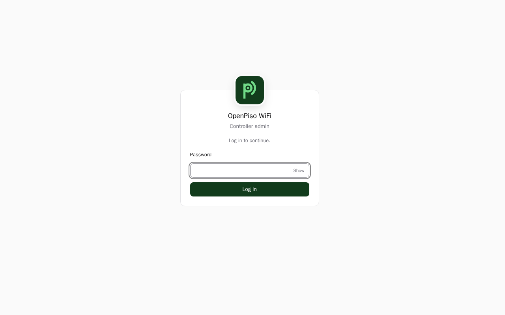

# Install the Controller

The **Controller** is the small Linux board at your **Shop** (the place you sell WiFi time) that keeps the record of the time each customer bought and tells your MikroTik **Router** who may go online. In this step you prepare the board from a Windows PC, install the Controller on it, and log in to its admin panel.

It takes about 30 minutes. You type every command below; you can copy and paste them.

## What you need for this step

- The board: an Orange Pi Zero (tested), a Raspberry Pi, or any arm64 or amd64 computer that runs Linux with systemd.
- A microSD card for the board, and a card reader for your PC.
- A network cable from the board to your MikroTik's LAN.
- A Windows PC on the same network.

## 1. Write the SD card

1. On your PC, download the operating system for your board:
   - Orange Pi Zero: **Armbian** from [armbian.com](https://www.armbian.com/download/).
   - Raspberry Pi: **Raspberry Pi OS Lite**. Raspberry Pi Imager downloads it for you.
2. Install an SD card imager: [balenaEtcher](https://etcher.balena.io/) or [Raspberry Pi Imager](https://www.raspberrypi.com/software/).
3. Put the microSD card in your PC, open the imager, choose the image (or, in Raspberry Pi Imager, the OS) and the card, and write it. With Raspberry Pi Imager, use its settings to set a username and password and to turn on SSH before you write.

> **Screenshot to come:** the imager with the image and the SD card selected, ready to write.

4. Put the card in the board, connect the network cable, and power it on. Give it a few minutes to start the first time.

## 2. Find the board's address and keep it fixed

The board gets its address from your MikroTik. Open the MikroTik's DHCP leases (in WebFig or Winbox: **IP › DHCP Server › Leases**) and find the board. Its address looks like `192.168.10.2`.

Make that lease static so the address never changes: the Controller tells the Router this address, and customers' phones reach the Controller through it.

The examples on this page use `192.168.10.2` for the board and `192.168.10.0/24` for your network. Use your own values.

## 3. Connect to the board from PowerShell

Windows has SSH built in. Open **PowerShell** from the Start menu and type, using your board's address:

```powershell
ssh root@192.168.10.2
```

On Raspberry Pi OS, use the username you set in the imager instead of `root`. Type `yes` if asked whether to trust the board, then the password. On Armbian, the first login asks you to set new passwords; follow its prompts.

You are now typing commands on the board, not on your PC.

> **Screenshot to come:** PowerShell connected to the board over SSH.

## 4. Install the Controller

Pick the file for your board:

| Board | File |
| --- | --- |
| Orange Pi Zero | `openpiso-linux-armv7` |
| Raspberry Pi with the 64-bit OS | `openpiso-linux-arm64` |
| Raspberry Pi 2 or newer with the 32-bit OS | `openpiso-linux-armv7` |
| A PC (Intel or AMD) | `openpiso-linux-amd64` |

Then run these commands on the board. They download the latest Release and install it. Replace `openpiso-linux-armv7` if your board needs a different file, and change the two addresses on the last two lines:

```sh
base=https://github.com/H3atman/openpiso-wifi/releases/latest/download
curl -fLO "$base/openpiso-linux-armv7"
curl -fLO "$base/openpiso-install.tar.gz"
tar -xzf openpiso-install.tar.gz
cd install
sudo sh install.sh --binary ../openpiso-linux-armv7 \
  --portal-url http://192.168.10.2 \
  --admin-network 192.168.10.0/24
```

- `--portal-url` is `http://` followed by the board's address from step 2. It must be the address in numbers, not a name.
- `--admin-network` is the network allowed to open the admin panel, written like `192.168.10.0/24`. Your PC must be inside it. Keep the address your Router uses when it passes customer traffic on (its NAT address) out of it, or customers could reach your admin login page.

The installer then asks for an **admin password** and asks you to type it again. Nothing shows while you type. This is the password for the admin panel; keep it safe.

When it finishes, it prints:

```
OpenPiso Controller is running on 0.0.0.0:80 (portal http://192.168.10.2).
```

If it prints `openpiso service did not become healthy; see journalctl -u openpiso` instead, run `sudo journalctl -u openpiso` to see why.

The Controller now starts by itself every time the board powers on. Running the installer again keeps your data and your password.

## 5. Open the admin panel

On your PC, open a browser and go to your board's address followed by `/admin/login`:

```
http://192.168.10.2/admin/login
```

Type the admin password and select **Log in**. You see the Dashboard.



If the browser shows `management network only`, your PC is not inside the `--admin-network` you chose. After five wrong passwords, the login is blocked from your PC for five minutes.

## If you need to change a setting later

The installer saves the portal URL, the admin network and the listen address in `/etc/openpiso/openpiso.env`. Only root can read it, so edit it with `sudo`, for example `sudo nano /etc/openpiso/openpiso.env`, then restart the Controller:

```sh
sudo systemctl restart openpiso
```

To check that the Controller is running, use `systemctl status openpiso`; to read its log, use `sudo journalctl -u openpiso`.

For every detail of the installer, see the [Controller reference](https://github.com/H3atman/openpiso-wifi/blob/main/controller/README.md#install-on-armbian--raspberry-pi-os-lite).

Next: [Connect the Router](connect-the-router.md).
