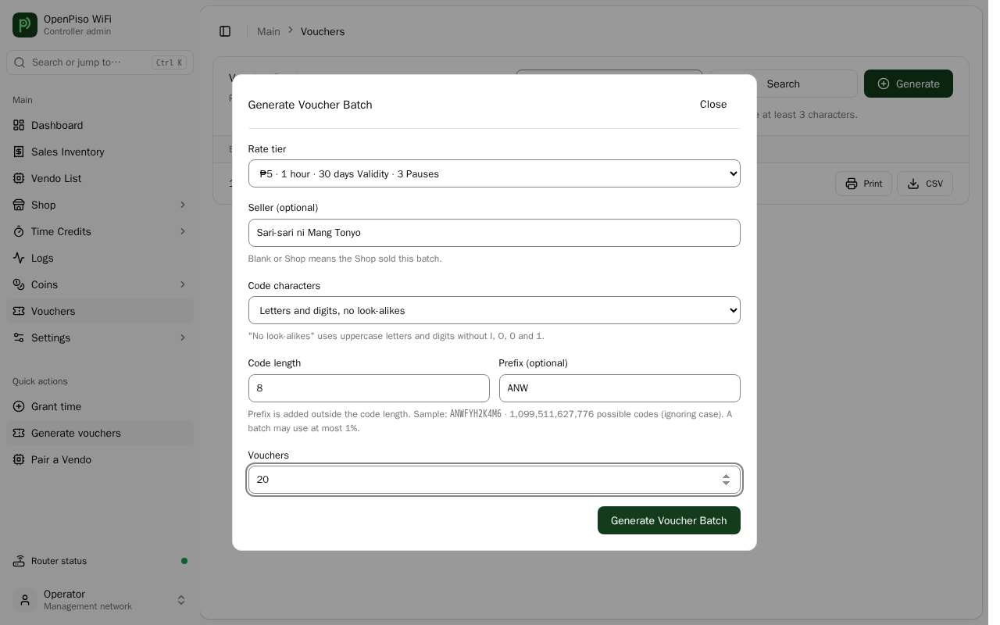
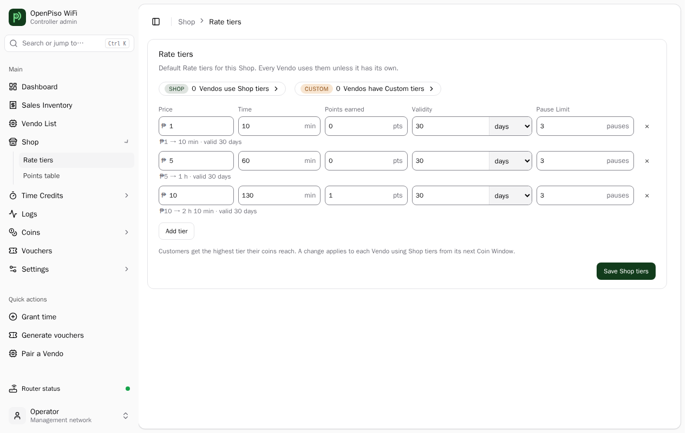
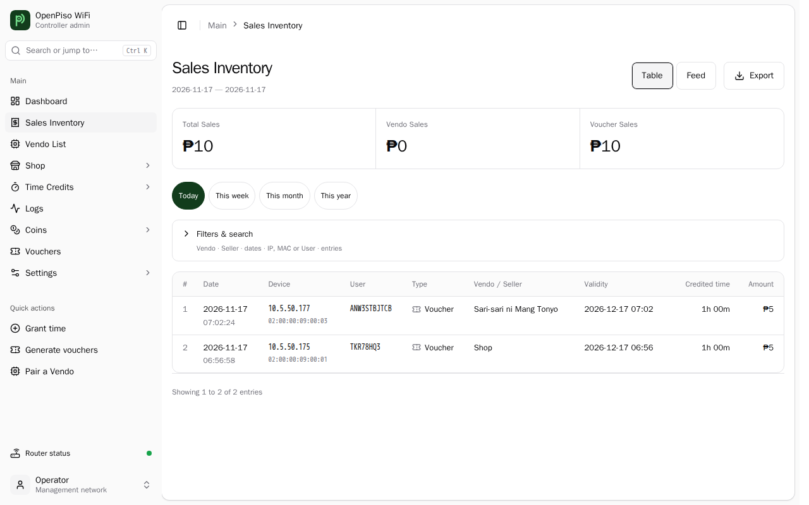
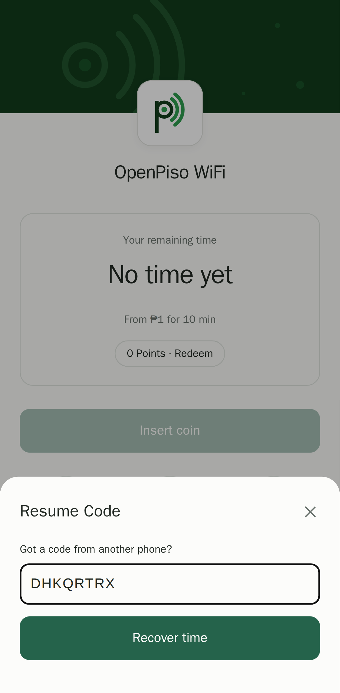
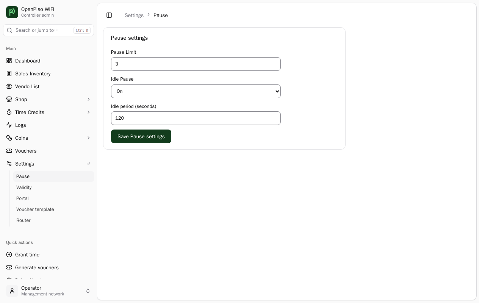
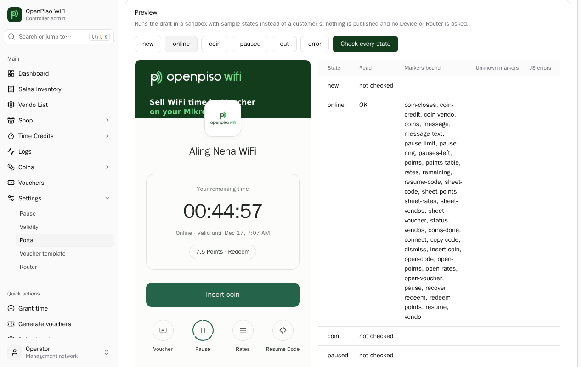

# Run the Shop day to day

This page covers the tasks you do once your Shop is selling: making Vouchers, setting prices, checking Sales, helping customers, and changing your rules and your Portal. Every task starts in the admin panel, at your board's address followed by `/admin/login`.

## Make and sell Vouchers

You made your first Voucher in [Sell your first Voucher](sell-your-first-voucher.md). Day to day it works the same way, with a few more choices.

1. Open **Vouchers** and select **Generate**.
2. In **Rate tier**, pick one of your prices, or leave **Custom**:
   - A Rate tier copies its price, time, Validity and Pauses into the Batch. Set your Rate tiers under **Shop › Rate tiers** (see [Set your prices](#set-your-prices)).
   - **Custom** lets you type **Time (seconds)** and **Price (pesos)** yourself. The Batch then uses your Shop's Validity and Pause Limit from **Settings › Validity** and **Settings › Pause**.
3. In **Seller (optional)**, type who sells this Batch, for example the name of the store that resells your Vouchers. Leave it blank if you sell them yourself. Sales then show who sold each Voucher.
4. Change the code if you want:
   - **Code characters**: **Digits**, **Uppercase letters**, **Letters and digits, no look-alikes** (the default) or **Mixed case and digits**.
   - **Code length**: 4 to 10 characters.
   - **Prefix (optional)**: up to 6 letters or digits put in front of every code, for example your Shop's initials. It is not counted in the code length.
   - The window shows a sample code. A Batch may use at most 1% of the possible codes, so very short codes allow only small Batches.
5. In **Vouchers**, type how many to make, up to 1000.
6. Select **Generate Voucher Batch**, then **Open Print sheet**, and print it.

The **Voucher Batches** table lists every Batch, newest first, with its **Seller**, **Rate tier**, **Price**, **Time**, how many **Vouchers** it has and how many are **Redeemed** (used). On each row:

- **Print** opens the Print sheet again. Used Vouchers are marked `USED` on it.
- **CSV** downloads the Batch's codes as a spreadsheet file.
- **Delete** removes the Batch, only while none of its Vouchers is used. Its Vouchers stop working. This cannot be undone.

To find one Voucher, type at least 3 characters of its code in the search box and select **Search**. The result shows whether it is **Unused** or **Redeemed**, and when.

To change how Vouchers look on paper, open **Settings › Voucher template**. **Shop name** changes the name printed on them. The rest of the page edits the Voucher's layout as code, for those who know HTML.

A Voucher counts as Sales when a customer uses it, not when you print it.

## Set your prices

Your prices live under **Shop**. A Vendo uses the Shop's prices unless you give it its own, so you set them once for the whole Shop.

### Rate tiers

A **Rate tier** is a price and what it buys. Coins use your Rate tiers: the highest tier the customer's coins reach prices all the coins they drop. Vouchers can copy a Rate tier too, as above.

1. Open **Shop › Rate tiers**.
2. For each tier, fill in:
   - **Price**: whole pesos. The first tier must be ₱1.
   - **Time**: in minutes.
   - **Points earned**: Points the customer earns with this tier. `0` gives none.
   - **Validity**: how long the customer has to use the time, in minutes, hours, days or weeks, or **No limit**.
   - **Pause Limit**: how many times the customer may pause this time.
3. Select **Add tier** for another tier, or **×** to remove one.
4. Select **Save Shop tiers**.

A higher tier must give at least as much time per peso as the tier before it, and at least as many Points per peso. For example, ₱1 for 10 minutes and ₱5 for 60 minutes is allowed; ₱5 for 40 minutes is not. If a tier breaks a rule, the page says which one and saves nothing.

A change applies from the next coin purchase. It does not change Vouchers you already printed.

### Points table

**Points** are a small balance customers earn with coins and can trade for time on the Portal. Vouchers never earn Points. The **Points table** sets what Points buy.

1. Open **Shop › Points table**.
2. Select **Add row**. Fill in **Points cost**, **Time** (in minutes), **Validity** and **Pause Limit**.
3. Select **Save Shop Points table**.

An empty table means customers cannot trade Points for time. The table starts empty.

## See today's Sales

**Sales** are the pesos your Shop takes in: coins from Vendos, plus the price of each Voucher when a customer uses it. Time you give away yourself is never Sales.

The **Dashboard** shows your Sales for today, this week, this month and this year. Select one to see its Sales.

**Sales Inventory** lists every sale:

1. Open **Sales Inventory**. It starts at this month.
2. Select **Today** (or **This week**, **This month**, **This year**). The top shows **Total Sales**, split into **Vendo Sales** and **Voucher Sales**.
3. To narrow the list, open **Filters & search** and choose a **Vendo**, a **Seller**, the dates in **From** and **To**, or search by the customer's IP, MAC or User. Select **Show Sales**.
4. **Table** and **Feed** switch between a table and a list by day.
5. **Export** downloads every sale that matches your filters as a spreadsheet file.

Each sale shows its date and time, the customer's Device, whether it was a **Coin** or a **Voucher**, who sold it, how much time it gave and the **Amount**. A Voucher from a Batch with no price shows `Unknown`.

## Help a customer who lost their time

A customer's time is kept on the Controller, not on their phone. They do not lose it when they close the Portal, switch off WiFi, or change phone. Only one **Device** (a phone, as your WiFi sees it) at a time can use it.

### Same phone, same browser

If the phone changed its address, the Portal finds the time by itself when the customer opens it in the browser they paid in. It shows `Moving your time to this phone…`, then the time left. If this takes too long, the customer taps **Connect**.

### Another phone or browser, or the Portal does not find the time

The customer needs their **Resume Code**: the 8-character code the Portal showed under **Resume Code** after they paid. Ask them to:

1. Open the Portal on the phone they want to use.
2. Tap **Resume Code**.
3. Type the code in **Got a code from another phone?** and tap **Recover time**.

The time moves to this phone, which goes online, even if the customer had paused it. The old phone goes offline. Moving a Time Credit from one Device to another is called **Rebind**; it never adds or loses time.

What the customer may see:

- `Resume Code invalid. Enter the eight characters shown after your purchase.` or `Resume Code not found. Check the code shown after your purchase.`: the code is mistyped. Check it with them.
- `Too many Resume Code attempts. Try again in five minutes.`: five wrong codes from one phone. Wait five minutes.
- `This code has expired`: the time's Validity ended, so the unused time is gone. They buy new time.

### The customer has no Resume Code

Only the Resume Code can move time to another phone. The admin panel cannot move it, but you can make up the time.

First find the customer's time:

1. Open **Time Credits**. Each **Time Credit** is one customer's time. Search by MAC, IP or state, or pick **Online now**, **Paused** or **Expired** in the sidebar.
2. Select the customer's Time Credit. It shows **Bought**, **Used · Router-metered**, **Remaining** and **Validity**, and a **Timeline** of what happened to it.

**If they are on the same phone**, add time to that Time Credit: type the time in **Seconds** and why in **Reason**, then select **Grant time**. The page says `Grant recorded and applied to the Router.` The time goes to the Device the Time Credit is on now, so this does not help a customer on a new phone. Granted time uses your Shop's Validity and Pause Limit, and it is never Sales. You cannot grant time to a Time Credit whose Validity has ended.

**If they have a new phone**, give them a free Voucher instead. On **Vouchers**, generate a Batch of 1 with **Custom**, **Price (pesos)** `0` and **Time (seconds)** set to the time left on their old Time Credit (1 hour is 3600 seconds), as in [Make and print Vouchers](#make-and-sell-vouchers). The customer types it on the Portal of the new phone. A ₱0 Voucher adds ₱0 to Sales. The old Time Credit keeps its time, and the old phone can still use it.

## Change Pause and Validity rules

### Pause

A **Pause** lets a customer stop their time and keep the rest for later, by tapping **Pause** on the Portal. An **Idle Pause** stops it by itself when their phone has been inactive for a while.

1. Open **Settings › Pause**.
2. Set:
   - **Pause Limit**: how many Pauses a customer gets with each purchase, 0 to 1000. The default is 3.
   - **Idle Pause**: **On** or **Off**. The default is **Off**.
   - **Idle period (seconds)**: how long a phone may be inactive before Idle Pause, 1 to 86400. The default is 120.
3. Select **Save Pause settings**.

Saving updates the Router straight away. Customers who are online are logged in again so the new rules apply to them. Idle Pauses never count toward the Pause Limit.

The Pause Limit here applies to Custom Voucher Batches and time you grant. A Rate tier and a Batch made from one carry their own Pause Limit.

### Validity

**Validity** is how long a customer has to use their time. When it ends, the unused time is gone. Each new purchase starts it again.

1. Open **Settings › Validity**.
2. Type a whole number in **Validity** and choose a **Unit**: seconds, minutes, hours or days. The default is 30 days; the most is 36500 days.
3. Select **Save Validity**.

The page shows `Unused time expires … after the last Top-up.` A change applies to purchases from now on, not to time customers already have. Like the Pause Limit, it applies to Custom Voucher Batches and granted time; Rate tiers carry their own Validity.

## Customize the Portal

The **Portal** is the page customers' phones open when they join your WiFi. The Controller ships with a Default Portal. You can change its pictures, its colours and its words.

### Change the logo and the cover

1. Open **Settings › Portal** and go to **Cover and logo**.
2. In **Logo image**, choose a picture from your PC and select **Upload logo**. Your browser crops it to a square and makes it small enough.
3. In **Cover image**, choose a picture for the banner at the top. Move **Focus** to the part of the picture to keep, then select **Upload cover**.

Each upload saves a draft. Customers do not see it yet.

### Change the words and colours

The Portal is three files: `index.html` (the page), `portal.css` (the colours and layout) and `custom.js` (optional). They are shown in boxes on **Settings › Portal**. Editing them needs some HTML and CSS. For example, the Shop name at the top of the page is the line `<h1>OpenPiso WiFi</h1>` in `index.html`.

1. Change the files in their boxes. Keep `<script src="/portal/core.js">` and the required markers listed in the [Portal contract](https://github.com/H3atman/openpiso-wifi/blob/main/docs/portal-contract.md).
2. Select **Save draft**. The page checks the files. It shows `Draft saved (version …). Publish it to show it to customers.`, or lists what to fix and saves nothing.

If you get lost, **Download default** gives you the Default Portal's files to start again.

### Check it and publish it

1. Under **Preview**, select each sample state (`new`, `online`, `coin`, `paused`, `out`, `error`), or **Check every state**. The preview runs your draft with sample data; no customer sees it. The table under it lists any problem.
2. Under **Versions**, select **Publish draft**. Customers now see your Portal.

If something is wrong after publishing, **Revert to previous** brings back the version customers saw before. After your first publish there is no earlier version, so **Revert to previous** is greyed out; use **Reset to default** instead. **Reset to default** brings back the Default Portal; **Revert to previous** undoes that too.

## Other pages

**Time Credits.** Every customer's time is a Time Credit, kept without a name or login. This page lists them with what each bought, used and has left, as the Router counts it. Use it to look up a customer, to grant time, and to read the **Audit inbox**, where the Controller puts coin reports it could not match for you to review.

**Logs.** A live list, newest first, of coins, Vouchers used, Rebinds, grants and audit flags. Filter it with **All**, **Coins**, **Vouchers**, **Rebinds**, **Grants** or **Audit**. Pauses are not logged.

**Coins.** **Coin sales** shows the coins each Vendo has taken and the time they bought, and warns about any gap in a Vendo's coin count. Coin sales stays empty until you [add a Vendo](add-a-vendo.md). **Credit intents** lists each change of a customer's time that the Controller sends to the Router, for Vouchers and grants too. A `pending` one has not reached the Router yet; the Controller retries it by itself about every 10 seconds.

For every detail, see the [Controller reference](https://github.com/H3atman/openpiso-wifi/blob/main/controller/README.md).

Next: [Update](update.md).
