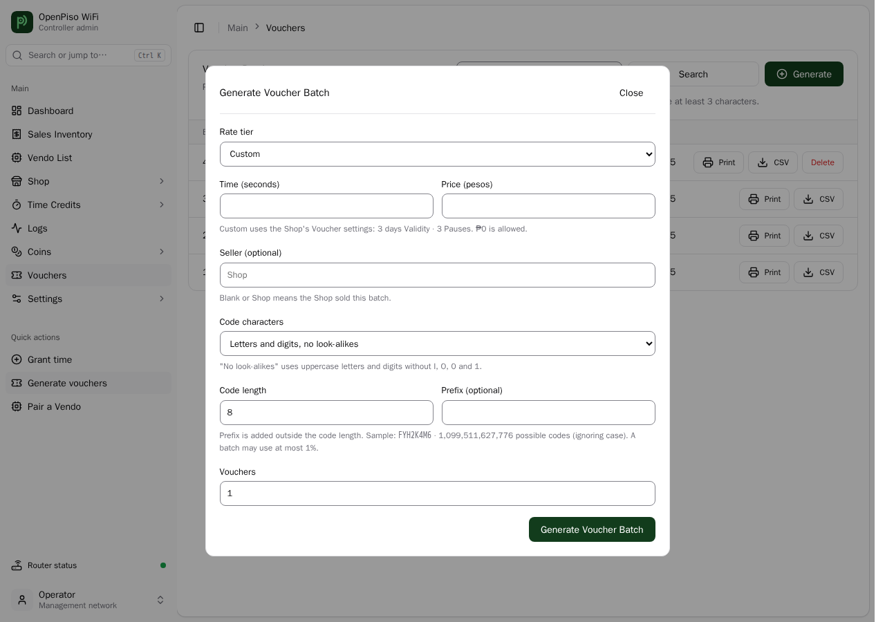
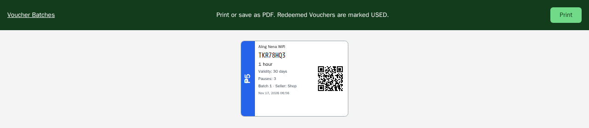
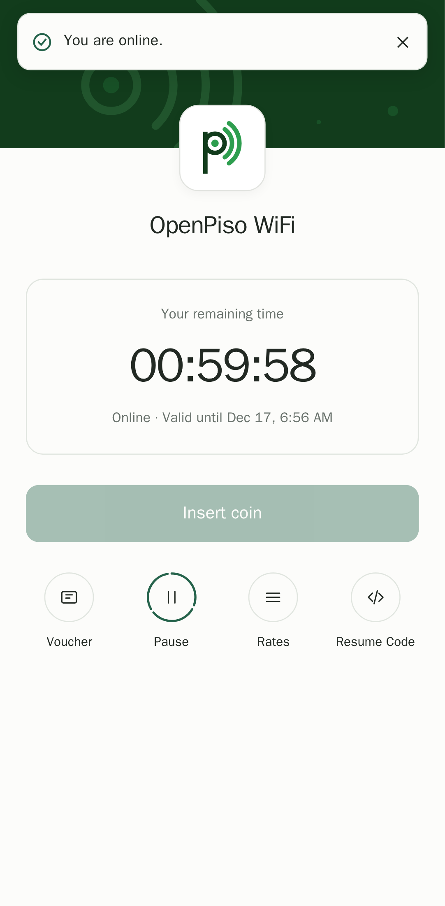
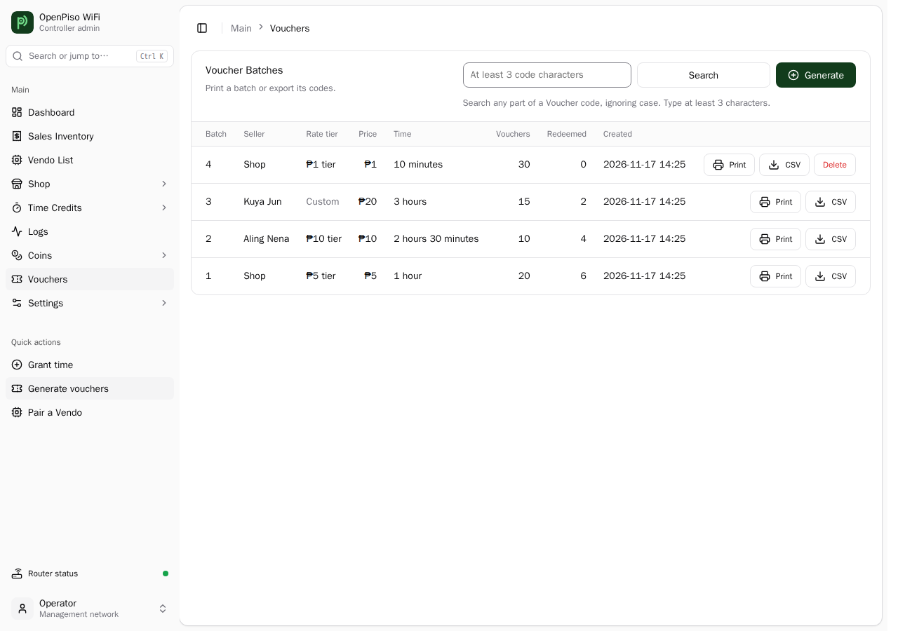

# Sell your first Voucher

A **Voucher** is a printed code, used once, that is worth a fixed amount of time. You make Vouchers in a **Voucher Batch** (a numbered set of Vouchers made together, all with the same price and time), print them, and sell them. A customer types the code on the **Portal** (the page their phone opens when it joins your WiFi) and goes online.

In this step you make one Voucher, print it, and use it on a phone to check that everything works. It takes about 10 minutes.

## 1. Put your Shop's name on the Vouchers

This step is optional. Without it, Vouchers show `OpenPiso WiFi`.

1. In the admin panel, open **Settings › Voucher template**.
2. Type your Shop's name in **Shop name** and select **Save Shop name**.

## 2. Make a Voucher Batch

1. Open **Vouchers** and select **Generate**. The **Generate Voucher Batch** window opens.
2. Fill in:
   - **Rate tier**: leave it on **Custom**.
   - **Time (seconds)**: the time the Voucher is worth, in seconds. Type `3600` for one hour.
   - **Price (pesos)**: what the customer pays, for example `5`. `0` is allowed, for a free Voucher.
   - **Seller (optional)**: leave it blank. Blank means your Shop sold it.
   - **Code characters**, **Code length** and **Prefix (optional)**: leave them as they are. Codes then have 8 capital letters and digits, without `I`, `O`, `0` or `1`, so they are easy to read.
   - **Vouchers**: how many to make. Leave it at `1`.
3. Select **Generate Voucher Batch**.

Below **Custom** the window also shows the Shop's Validity (how long the customer has to use up the time) and Pauses (how many times they may pause it). You can change them later under **Settings › Validity** and **Settings › Pause**.

The page shows `Voucher Batch generated.` and the new Batch at the top of **Voucher Batches**.

## 3. Print it

1. Select **Open Print sheet**. The **Print sheet** (the Batch laid out as Vouchers, ready to print) opens in a new tab.
2. Select **Print**. Print it, or choose to save it as a PDF.

Each Voucher shows the price, the code, the time, the Validity and the Pauses, and a QR code that opens the Portal. You can open the Print sheet again at any time with **Print** on the Batch's row.

## 4. Use it on a phone

Try the Voucher yourself before you sell one. If its price is not `0`, your test counts as a sale.

1. On a phone, join your Shop's WiFi, the network your HotSpot server runs on. The Portal opens by itself. If it does not, open a browser and go to any `http://` website, such as `http://neverssl.com`.
2. Tap **Voucher**.
3. Type the code from the Voucher in **Voucher code** and tap **Use Voucher**.

The Portal shows `You are online.` and the time counting down. The phone can now browse.

The Portal also shows a **Resume Code**: a short code the customer keeps to get their time back if they change phone or browser.

If the Portal says `Voucher invalid. Enter the letters and digits printed on it.`, check the code and type it again. After five wrong codes, that phone must wait five minutes.

## 5. See the sale

Back in the admin panel:

- **Vouchers**: the Batch's **Redeemed** column shows `1`. On its Print sheet, the Voucher is marked `USED`.
- **Sales Inventory**: the price appears under **Voucher Sales**. A Voucher counts as a sale when the customer uses it, not when you print it.

Your Shop is selling WiFi time. Now sell Vouchers the same way: make a Batch of as many as you need, print the sheet, and cut them out.

Next: [Add a Vendo](add-a-vendo.md).
