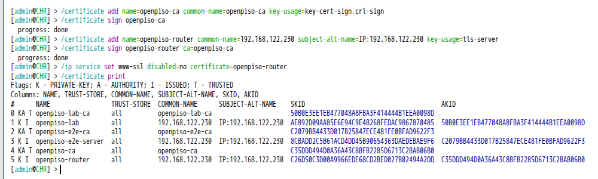

# What you need

OpenPiso WiFi lets you sell WiFi time at your **Shop** (the place you sell WiFi time) with **Vouchers**: printed codes, each worth a fixed amount of time, that a customer types on their phone to go online. Coin **Vendos** (networked coin slots) are coming.

Three things work together:

- The **Controller**: a small Linux board that keeps the record of the time each customer bought and runs the admin panel, where you set prices and print Vouchers.
- The **Router**: your MikroTik. It lets customers online and counts the time they use, on the Controller's instructions.
- The **Portal**: the page a customer's phone opens when it joins your WiFi. The Controller serves it; the customer types a Voucher there.

This page lists the hardware and what your Router must already do before you start.

## Hardware

### Tested

These are what OpenPiso WiFi is tested on:

- **Controller**: Orange Pi Zero running Armbian.
- **Router**: MikroTik running RouterOS v7.
- **Vendo**: ESP8266 4 MB LAN coin boards (KiTifi or JuanFi). Vendos are not yet part of this Guide.

### Should work

These are not tested yet, but should work as the Controller:

- A Raspberry Pi running Raspberry Pi OS Lite.
- Any arm64 or amd64 computer that runs Linux with systemd.

### Also needed

- A microSD card for the board, and a card reader for your PC.
- A network cable from the board to your MikroTik's LAN.
- A Windows PC on the same network, with Winbox or a browser to manage the MikroTik.
- A printer, or a way to save a PDF, to print Vouchers.

## Your Router before you start

This Guide starts from a MikroTik that already sells WiFi through a working **HotSpot server** (the RouterOS feature that holds customers at a login page until they may go online). It does not set up the HotSpot itself. Check each item below; the links go to MikroTik's own documentation.

- [ ] **RouterOS v7.** In WebFig or Winbox, **System › Resources** shows the version. It must start with `7.`. To upgrade, see [Upgrading and installation](https://help.mikrotik.com/docs/spaces/ROS/pages/328142/Upgrading+and+installation).
- [ ] **A working HotSpot server**, with its network and DHCP server, that customers' phones already join. See [HotSpot – Captive portal](https://help.mikrotik.com/docs/spaces/ROS/pages/56459266/HotSpot+-+Captive+portal).
- [ ] **`www-ssl` turned on, with a certificate.** `www-ssl` is the Router's HTTPS service; the Controller manages the Router through it. The certificate must name the address the Controller uses to reach the Router, for example `192.168.10.1`. See [Services](https://help.mikrotik.com/docs/spaces/ROS/pages/103841820/Services) and [Certificates](https://help.mikrotik.com/docs/spaces/ROS/pages/2555969/Certificates). If you have none yet, the commands below make one.
- [ ] **The Router admin username and password**, for a user with full rights. You type them once, when you connect the Router.
- [ ] **The board on your MikroTik's LAN**, where the Router can reach it and it can reach the Router. Customers' traffic to the board must keep the customer's own address: if your NAT masquerade rule has no out-interface, give it your internet port, so it does not change traffic going to the board.

### Make a certificate for `www-ssl`

Skip this if `www-ssl` already has a certificate for the Router's address.

Open the terminal (**Terminal** in WebFig, **New Terminal** in Winbox) and paste these lines one at a time. Replace `192.168.10.1` with the address of your Router on the board's network, in both places:

```
/certificate add name=openpiso-ca common-name=openpiso-ca key-usage=key-cert-sign,crl-sign
/certificate sign openpiso-ca
/certificate add name=openpiso-router common-name=192.168.10.1 subject-alt-name=IP:192.168.10.1 key-usage=tls-server
/certificate sign openpiso-router ca=openpiso-ca
/ip service set www-ssl disabled=no certificate=openpiso-router
```

Signing can take a few seconds each. The Controller accepts this certificate because you confirm its fingerprint when you connect the Router.



## What the Controller changes on your Router

When you connect the Router, the Controller sets up the Router for you. You do not type any of this; it is listed so you know what to expect:

- It adds a Router user and group named `openpiso-controller`, with a random password, and uses only that user from then on. Your admin password is not saved.
- It adds two HotSpot user profiles, `openpiso-no-idle` and `openpiso-idle`.
- It sets every HotSpot server profile in use to log customers in by `http-pap` only, with the `hotspot` HTML directory.
- It adds one walled-garden rule, `openpiso-controller`, so customers who have not paid can still open the Portal.
- It replaces the HotSpot's `hotspot/login.html` with a page that sends customers to the Portal.

If you had your own HotSpot login page, it is replaced. The Controller checks these settings every time it starts and puts back any that were changed.

Next: [Install the Controller](install-the-controller.md).
