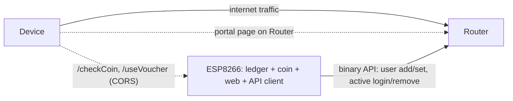

# JuanFi v4.4 architecture (LanBased ESP8266, static)

Prior art for the Controller and Vendo. JuanFi is the open-source ESP8266 Piso-WiFi vendo (`github.com/ivanalayan15/JuanFi`); this is its v4.4 "LanBased" build (ESP8266 + W5500 Ethernet), recovered from the two release flash images, the v4.4 MikroTik portal template, and the official repo's README and older templates. Terms below follow `GLOSSARY.md`; JuanFi's own names appear in `code` only when they differ.

Evidence: firmware strings, SPIFFS contents, the portal template and the README's Router scripts. The Xtensa code was not disassembled, so firmware control flow is inferred from strings and marked **(inferred)**. The repo's firmware source is v2.4 (`CURRENT_VERSION "2.4"`), so it shows design lineage, not v4.4 code. Raw artifacts (decoded web portal, string dump, extractor scripts) live at `/mnt/local-disk-d/Projects/random/juanfi-bin/release-4.4/release/LanBased/ESP8622/analysis/`.

## 1. The one-box model

JuanFi collapses Controller and Vendo into one ESP8266. That single microcontroller:

- owns the ledger (flat files on its own flash),
- reads the coin acceptor on a GPIO interrupt,
- serves the public coin/Voucher API and the admin page,
- drives the Router over the RouterOS **binary API** (`/ip/hotspot/...` sentences parsed via `=.proplist=`, `!done`, `!trap`).

The customer portal is not in the image: SPIFFS holds only `/admin/*`. The public endpoints set CORS headers, so the customer page is served from the Router's HotSpot folder and calls the ESP cross-origin **(inferred)**.

Contrast with ADR 0001: openpiso-wifi splits these roles. The Controller is an SBC and owns the ledger, portal and Router client; a Vendo only reports coins. Treat JuanFi's merging of them as the thing being undone, not copied.

## 2. Flash layout

| Image | Offset | Contents |
|---|---|---|
| `FlashFile1.bin` | `0x000000` | 2nd-stage bootloader, then the app image at `0x1000`. Arduino-ESP8266 core `2.2.2-dev(38a443e)`, SDK built Jul 2019, lwIP, W5500 "EthernetWebServer v1.6.0". 4 MB QIO flash. |
| `FlashFile2.bin` | `0x200000` | SPIFFS (256 B pages, 8 KB blocks): admin HTML/JS/CSS (mostly gzip) and `/admin/config/*.data`. |

## 3. Ledger: positional flat files

All state sits in delimited text on SPIFFS. Records are split on `|` and fields within a record on `#`. Fields are identified by position only:

| File | Holds |
|---|---|
| `system.data` | ~35+ positional settings: vendo name, Wi-Fi, Router IP/user/password, admin credentials, coin wait, abuse/ban, GPIO pins, voucher prefix, LCD text, IP mode, API key |
| `rates.data` | rate tiers: `name#price#minutes#validity#dataLimit#profile` |
| `chg-rates.data`, `charging.data` | phone-charger port rates and per-port state |
| `eload-set.data`, `eload-trx.data`, `eload.csv` | prepaid-load reseller settings and transactions |
| `logs.data` | system log |

Every write is a read-modify-write of a whole file **(inferred)**: there are no transactions, and nothing records time bought separately from the Router. Compare the Ledger module in issue #5, which owns all atomicity rules.

## 4. Entitlement = HotSpot user named by a random code

JuanFi has no Entitlement separate from the Router. Paying in any way creates or extends one HotSpot user whose name is a random voucher code (`Start voucher random`, `Retrying to create a voucher`). The ESP then logs the Device in as that user (`Auto login:`, `/ip/hotspot/active/login`).

The ESP hands purchase details to the Router in the user's `comment`, as `time,amount,extendFlag,vendoName`. Everything after that is done by the Router's HotSpot on-login and on-logout scripts. The operator pastes these into the user profile (README step 8); the ESP does not push them.

- **Time** is written to the user as `limit-uptime`. A rate can also set `limit-bytes-total` and a profile. `session-time-left` is read back from the active list.
- **Top-up** is `extendTime`, which raises the existing user's limit and sets `extendFlag=1` in the comment.
- **Validity** is a per-rate field (the 4th field in `rates.data`), enforced by a Router `/system scheduler` that the on-login script creates per user.
  - The scheduler is named after the user. Its interval is the Validity, counted from first login, and a Top-up with `extendFlag=1` lengthens it.
  - When it fires it removes the user, its active session, its HotSpot cookie and its data file.
  - The on-logout script handles running out: on `session timeout` it sets the scheduler to 5 s, so the user is removed almost immediately.
- **Identity** is the Device's MAC plus the code. The on-login script writes `hotspot/data/<MACnocolons>.txt` = `code#validUntil` into the Router's HotSpot folder.
  - It first runs `/file print`, because RouterOS v6 can't create a file directly. That's why the template's `data.txt` is a `/file print` dump.
  - Every portal load fetches that file, fills the Voucher box and submits the HotSpot login.
  - This does the job of a cookie, but it is keyed on MAC and readable by any unpaid Device. A randomized MAC never finds its file.
- **Rebind** exists only as the optional `isRandomMacSyncFix` in the on-login script. When the same user logs in again, the script removes that user's other active sessions, so the newest Device wins.
  - It matches on the code alone, so anyone who knows the code can take the session.
  - Nothing records a Rebind.
- **Pause** does not exist: no pause strings appear in the firmware.

Takeaway for ADR 0003: JuanFi already lets the Router meter used time through `limit-uptime`, which is the same primitive. It does not keep its own record of time bought, so after any reset or file loss the Router is the only copy. Its state is also split across ESP files, Router users, schedulers, script sources and public data files, with nothing reconciling them.

## 5. Coin flow (the Coin Window analogue)

1. The customer taps insert on the portal, which calls `/checkCoin`. The coin slot is reserved for that customer, and a second customer sees `coinslot.busy`.
2. The ESP waits up to `waitTime` (coin wait, default 30 s) for pulses. Coins can also come from a bill acceptor.
3. On "done", or when the wait expires with coins counted, the total is matched to a rate tier and becomes a voucher that is auto-applied (`Coin insert waiting expired, Auto using the voucher`).
4. A customer who opens the slot and inserts nothing gets a strike against their MAC. After the abuse count (default 3) their MAC is banned for the ban period (default 30 min): `coin.slot.banned`, `unlocking mac address...`.

Status codes returned to the portal: `coin.is.reading`, `coin.not.inserted`, `coins.wait.expired`, `coin.slot.notavailable`, `no.internet.detected`.

This maps closely onto Coin Window (issue #16): one window per coin unit, a busy refusal, crediting on timeout, and tiers applied to the window total. What openpiso-wifi adds is distance. In JuanFi the acceptor is wired straight to the GPIO, so there is no network hop and no resend to deduplicate. A networked Vendo needs the sequence-numbered, signed coin reports from issue #5. JuanFi's MAC-ban for abandoned windows has no counterpart in the spec yet.

## 6. HTTP surface

- **Public (customer):** `/checkCoin`, `/useVoucher`, `/convertVoucher`, `/cancelTopUp`, `/testInsertCoin`, `/health`, `/ping`, `/eload/{rates,topUp,process}`.
- **Admin:** `/admin/login.html` posts to `/validateLogin`, which returns `ok|<token>`. Later calls send that token in an `X-TOKEN` header. There are two roles, admin and operator. The admin API under `/admin/api/` covers:
  - dashboard and sales stats
  - system config
  - rates, plus Voucher generation and printing
  - active users and kicking them
  - SSID scan
  - restarting the ESP and the Router
  - logs
  - nightlight
  - eload
- **OTA:** `/admin/updateMainBin` replaces the firmware.

## 7. Router control

The ESP's binary-API commands seen in the firmware:

- `/ip/hotspot/user/{add,set,remove,print}`
- `/ip/hotspot/active/{login,remove,print}`
- `/system/script/{set,run,print}`
- `/tool/fetch`
- `/system/reboot`

The ESP logs in as an API user that the operator creates on the Router (README step 7, default `pisonet` / `abc123`). Its password is kept in plaintext in `system.data`, and its permission group is whatever the operator chose.

`/system/script` is used as storage, not for pushing logic. The README's setup creates two scripts, `todayincome` and `monthlyincome`, whose `source` holds a running sales total. The on-login script adds each sale to them, and Router schedulers reset them daily and every 30 days. The ESP reads and sets those sources for the dashboard figures (`todayincome`, `monthlyincome` in firmware strings) **(inferred)**.

The Router-side logic (Validity schedulers, the `/data/<MAC>.txt` file, sales counters, the random-MAC fix, optional Telegram and stats pings) lives in operator-pasted scripts, not in the ESP (see §4). The README's examples also have Router schedulers call the ESP's admin API, for example `/admin/api/restartSystem` and `toggerNightLight`. They authenticate with the static API key from `system.data` as `X-TOKEN`, and that key sits in plaintext on the Router.

## 8. Lapses to design against

Each row maps to a decision openpiso-wifi has already made (issue #5).

| JuanFi | openpiso-wifi |
|---|---|
| Ledger, web, coin and Router client on one ESP8266 | Controller SBC off the traffic path, with dumb Vendos (ADR 0001) |
| No record of time bought; the Router user is the only record | Ledger records time bought, the Router meters time used (ADR 0003) |
| Read-modify-write flat files, no atomicity | Ledger owns single-use Vouchers and exactly-once coin credit in SQLite WAL |
| Entitlement tied to Device MAC + code, remembered in a public `/data/<MAC>.txt` | Entitlement independent of Device; Rebind via signed cookie or Resume Code |
| No Pause | Pause, Pause Limit, Idle Pause (issue #8) |
| Router API credentials kept in plaintext | Admin credentials used once to create a limited API user, then discarded |
| RouterOS binary API | RouterOS v7 REST over HTTPS only |
| Default `admin`/`admin`; secrets returned to the browser by `getSystemConfig` | Password set at install; admin page only on the management network, rate-limited |
| Admin token issued over plain HTTP; client-side MD5 and `Math.random()` | Per-install HMAC key and signed cookie |
| Positional config with 35+ fields | Typed settings in the ledger |

## 9. Worth keeping

- `limit-uptime` on a HotSpot user as the meter, confirming ADR 0003 independently.
- Coin wait with busy refusal and auto-credit on timeout: the Coin Window shape.
- Rate tiers applied to the total inserted in one window.
- A refund voucher when a downstream purchase fails, which suits any future paid add-on.

## 10. QR purchase: the owner approves the customer

### 10.1 How JuanFi does it (template v4.x)

1. When `qrCodeVoucherPurchase` is on, the portal shows "Purchase Via QR". It renders `juanfi://purchasevoucher?mac=<mac>&ip=<ip>` client-side with `qrcode.min.js`. The payload is unsigned and doesn't expire.
2. The operator scans it with **JuanFi Manager**, a closed-source Android app (`com.juanfi.mobile.admin`) that isn't in the repo. The customer pays the operator in cash, and the app creates a Voucher **(inferred)**.
3. The portal polls `GET /data/<MACnocolons>.txt` on the Router every second. When the on-login script writes the file (§4), the portal reloads.
4. On reload, the portal reads the file (`voucherCode#validUntil`), fills the Voucher box and submits the HotSpot login.

### 10.2 Translation for openpiso-wifi: admin dashboard only

There is no separate app. The scanner is part of the Controller's admin dashboard, and the flow is a cash sale the operator approves there. It reuses the Top-up and Router login flows from issue #5, with no new Router behaviour.

1. **Customer requests.** The customer taps "Pay the owner" on the portal. The Controller creates a **purchase request** bound to the Device (MAC and IP from the walled-garden redirect) and its Entitlement (from the signed cookie, created if missing). The request has a random unguessable id, a ~5 min expiry, and can be used once.
2. **Portal shows the QR.** The Controller renders the request id as a QR in Go (e.g. `skip2/go-qrcode`), so no third party sees it. The payload is only the id; it means nothing without a logged-in admin session. Show the short id as text under the QR as well.
3. **Operator scans in the dashboard.** The dashboard has a "Scan customer QR" action. It decodes from a photo (`<input type="file" accept="image/*" capture>` plus a vendored decoder served as a static asset, with no build step per ADR 0002), using `BarcodeDetector` where the browser has it. A laptop webcam works as well as a phone.
4. **Fallback without scanning.** The dashboard also lists pending requests, newest first, with their short ids, so the operator can match by id when a camera isn't handy.
5. **Operator approves.** The dashboard shows the request's Device and the Entitlement's remaining time. The operator picks a rate tier and approves. In one ledger transaction, the request is marked used and the tier's time is credited as a Top-up. Approving twice credits once.
6. **Customer gets online.** The portal polls the Controller for the request's status, not a public file. On approval, the Controller runs the normal Top-up on the Router and logs the Device in. Expired or rejected requests show a clear message on the portal.

Open decisions:
- **Where the dashboard runs:** the admin page is management-network only (issue #5, story 43). Scanning happens on whatever device has the dashboard open, so an operator phone must join the management network; a laptop already on it needs nothing extra.
- **Sales accounting:** the spec's admin grants are compensation and stay out of sales. A cash sale has an amount and belongs in the sales report (story 56). That makes it a new purchase source beside coin credits, Voucher redemptions and admin grants, and the glossary has no term for it yet (nor for "purchase request"). Take both to `/domain-modeling`.
- **Placement:** the flow fits after Admin oversight (issue #13), as its own ticket under the MVP spec, or later.

## 11. Unknowns

- How `/validateLogin` checks credentials and how the token is generated, and whether `/admin/config/*.data` is served without a token. This needs disassembly.
- The exact semantics of `/convertVoucher` and `/cancelTopUp`.
- What the ESP uses `/tool/fetch` and `/system/script/run` for.
- How JuanFi Manager creates the Voucher after a scan (closed source).
