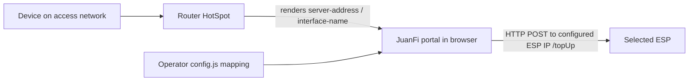

# Vendo auto-select by VLAN: JuanFi, KiTifi, and openpiso-wifi

Research / brainstorm input, 2026-10-29. The requested experience is **Insert Coin → the Vendo serving this Device's network**, without a picker. This note separates what the reference systems actually select on from the possible openpiso-wifi designs; it does **not** choose an implementation. Terms follow `GLOSSARY.md:25-40`: a Device is a transient MAC/IP binding, a Vendo is a coin unit, and a Coin Window reserves that unit for a Time Credit.

> **Evidence.** JuanFi source is pinned to `90f6142c74724eb3bdbc7c1d726327a802e2bc90`; remote source links below include line anchors. RouterOS facts come from MikroTik's current official documentation, not an assumed version of the lab Router. Local code is the checkout based on `a42d8e5`. KiTifi evidence is the repository's recorded reverse engineering, **not a fresh inspection of its closed-source PHP or binaries**: their provenance and unavailable/gitignored corpus are explicit in `docs/research/kitifi-controller-handoff.md:5-16` and `docs/research/kitifi-firmware/SUMMARY.md:8-12`. **(inferred)** labels deductions and proposed designs, not observed behavior.

## 1. What “auto select” means in the reference systems

### 1.1 JuanFi: explicit browser-side lookup, with two automatic modes

The official README advertises “Multi vendo system” and instructs Operators to give the ESP a static IP, configure HotSpot bypass, and edit the portal's address configuration ([README:40][Jread-feature], [README:294-316][Jread-setup]). The actual selection contract is more precise than that README:

| Setting in template 4.3 | Meaning in source | Default / evidence |
|---|---|---|
| `isMultiVendo` | Enable the configured list of ESP endpoints | `false`; [config.js:1-7][Jcfg] |
| `multiVendoOption = 0` | Customer chooses; remember the chosen IP in browser storage | Default `0`; [config.js:3-4][Jcfg], [core.js:92-109][Jselect] |
| `multiVendoOption = 1` | Match configured `hotspotAddress` against the current HotSpot servlet address, without its port | [core.js:75-83][Jselect] |
| `multiVendoOption = 2` | Match configured `interfaceName` against the Router-rendered interface name | [core.js:84-91][Jselect] |
| `vendorIpAddress` | The ESP HTTP endpoint actually called; also the fixed/default address | `10.1.0.41`; [config.js:41-42][Jdefault] |

The actual Router template supplies these values; they are **not** derived by scanning nearby ESPs:

```javascript
var hotspotAddress = "$(server-address)";
var interfaceName = "$(interface-name)";
```

Source: [`mikrotik-template/4.3/login.html:478-479`][Jlogin-vars]; also [`status.html:19-20`][Jstatus-vars]. The latter matters because an already-connected customer can extend time through the same selection mechanism ([status.html:128-135][Jstatus-button]).

The critical address-mode lookup, quoted verbatim from [core.js:75-83][Jselect]:

```javascript
if(isMultiVendo){
	  if(multiVendoOption == 1){
		$("#vendoSelectDiv").attr("style", "display: none");
		for(var i=0;i<multiVendoAddresses.length;i++){
			var currentHotspot = hotspotAddress.split(":")[0];
			if(multiVendoAddresses[i].hotspotAddress == currentHotspot){
				vendorIpAddress = multiVendoAddresses[i].vendoIp;
			}
		}
```

The interface-mode equivalent is `if(multiVendoAddresses[i].interfaceName == currentInterfaceName){ vendorIpAddress = multiVendoAddresses[i].vendoIp; }`; it also hides the picker ([core.js:84-91][Jselect]). The config's first example explicitly maps `hotspotAddress: "10.1.0.1"` and `interfaceName: "vlan11-hotspot1"` to `vendoIp: "10.1.0.41"`; its comment says interface mode preserves “one hotspot server ip only” ([config.js:3-14][Jcfg]).

**What the button does.** The template's `INSERT COIN` calls `insertBtnAction()` ([login.html:201-208][Jlogin-button]); that reaches `callTopupAPI(0)` ([core.js:264-298][Jinsert]). The latter sends:

```javascript
$.ajax({
  type: "POST",
  url: "http://"+vendorIpAddress+"/topUp",
  data: "voucher="+voucher+"&mac="+mac+ipAddCriteria+extendTimeCriteria,
```

Source: [core.js:515-518][Jtopup] (indentation normalized). Coin polling uses that same address for `/checkCoin`, and completion uses `/useVoucher` ([core.js:565-568][Jfinish], [core.js:633-637][Jpoll]). The published `.ino` registers `/topUp`, `/checkCoin`, `/useVoucher`, and `/cancelTopUp` ([firmware:271-276][Jroutes]). **The browser calls the chosen ESP directly; the Router supplies context and connectivity, not a “trigger VLAN” command.** [Jselect][Jtopup][Jroutes]

Important boundaries:

- **No subnet discovery in this selection path:** neither mode compares Device IP/netmask with board IP, broadcasts, derives `.254`, nor reads a numeric VLAN tag; both look up an Operator-maintained table ([config.js:6-34][Jcfg], [core.js:75-117][Jselect]).
- The inspected selection code uses neither `$(server-name)` nor `$(hostname)`; `$(server-address)` is the Router's HotSpot servlet endpoint, **not the ESP address** ([login.html:478-479][Jlogin-vars], [core.js:79-81][Jselect], [MikroTik variables][Mvars]).
- **(inferred)** A failed lookup leaves the configured default IP in use; duplicate mapping keys select the **last** matching entry. There is no `break`, missing-match error, or uniqueness check in these loops ([core.js:75-91][Jselect], [config.js:42][Jdefault]). Hiding the picker does not establish that a correct Vendo was found.
- The older `old template v2.4`, `v3.0`, `v3.2`, and `v3.3` `core.js` files inspected have the manual/stored-IP selector; do not attribute 4.3's automatic branches to all JuanFi versions ([v2.4:54-71][Jold], [v3.0:54-71][J30], [v3.2:54-71][J32], [v3.3:61-80][J33]).
- “Multi vendo” here is multiple configured ESP endpoints. No separate “Sub-Vendo” selection manual was found in the inspected official [repository tree][Jtree] or README; the table/comments and template code above are the primary evidence, not a claimed board-to-board protocol.
- Version caution: the repository `.ino` is older lineage, not proof of current released LAN firmware internals; existing research identifies it as v2.4 and distinguishes the separately recovered v4.4 artifacts (`docs/research/juanfi-architecture.md:3-5`). The auto-selection finding above is directly from the published **4.3 template**.

### 1.2 KiTifi: recorded HotSpot-server lookup; full UI mechanism not found

The strongest local statement is the controller handoff's start flow:

> `insert_coin_handler.php` resolves the node (`type='coins'` + hotspot server), checks activation, tells the board's `/insertCoin` URL to accept coins, and marks `cs_user`/`cs_active=1` on the vendo row.

Source: `docs/research/kitifi-controller-handoff.md:95-98`; independently restated in `docs/research/kitifi-firmware/server-contract.md:31-35`. This is **recorded analysis of the appliance's PHP**, not first-party public documentation and not the literal SQL predicate. It supports server-based selection, but does **not** establish how the portal obtains that server name, the precise mapping column, a setting literally called “auto select,” or tie-breaking among multiple matches.

What is better established on the board side:

| Evidence | Consequence / limitation |
|---|---|
| Heartbeat includes board MAC and local IP; the detailed LAN trace corrects the older contract: `host` is the board-name literal and MAC is a separate `mac` parameter | The controller can know the callback address; do not copy the contract's `host = MAC` shorthand (`docs/research/kitifi-firmware/board-behavior-esp8266-lan.md:233-248`). |
| Controller calls `http://<board-ip>/insertCoin`; IP is maintained in `tbl_vendo.ip` | Specific board activation is a controller callback, unlike JuanFi's direct browser call (`docs/research/kitifi-firmware/server-contract.md:24-29`). |
| LAN handler takes `coins`, `id`, `timer`, enables the acceptor; cancel/timeout disable it | Board receives the already-chosen paying session, not a customer VLAN selection request (`docs/research/kitifi-firmware/board-behavior-esp8266-lan.md:197-216`). |
| Configured `server_address`, fallback `kitifi.wifi` | This locates the **controller**, not the customer's local Vendo (`docs/research/kitifi-firmware/board-behavior-esp8266-lan.md:257-271`). |
| Wireless, ESP32-LAN and LAN8720 use the same endpoint/config family | No different board-selection mechanism was found in these variants (`docs/research/kitifi-firmware/board-behavior-esp8266-wireless.md:17-32,62-64`; `board-behavior-esp32-lan.md:125-144`; `board-behavior-lan8720.md:27-45`, all in that directory). |

Searches across `SUMMARY.md`, `server-contract.md`, all four `board-behavior-*.md`, and both strings inventories found **no documented board-side VLAN ID, subnet/broadcast selection algorithm, or “auto select” setting**. This is a bounded negative finding about those notes, not proof that the full product lacks a feature (`docs/research/kitifi-firmware/SUMMARY.md:45-62`; `esp8266-strings-inventory.md:6-37`; `esp32-strings-inventory.md:7-39`).

Evidence hygiene: some inventories/ESP32 notes call `kitifi.wifi` “mDNS”; the detailed ESP8266 trace identifies ordinary DNS via DHCP and `client.connect(..., 80)`. Use the latter for the analyzed ESP8266-LAN; do not infer broadcast discovery from the earlier label (`docs/research/kitifi-firmware/board-behavior-esp8266-lan.md:257-261`). Also, the firmware **never signals Done**: the synthesis explicitly corrects that older contract (`docs/research/kitifi-firmware/SUMMARY.md:74-86`).

**Public documentation: not found in this pass.** Web searches for `KitiFi "auto select" vlan`, `KitiFi auto select vendo hotspot vlan`, `"KiTifi" "VLAN"`, and `"KiTifi" "auto" "vendo"` returned no results. Later searches/fetches encountered tool upstream 429 errors. No accessible first-party website/Facebook/YouTube explanation or useful secondary tutorial was obtained; none is claimed as corroboration. The underlying decrypted PHP/corpus is not checked into this repo (`docs/research/kitifi-controller-handoff.md:9-16`; `docs/research/kitifi-firmware/SUMMARY.md:8-12`).

## 2. Mechanism: VLAN, HotSpot server, interface, and subnet are different keys

### 2.1 What RouterOS can put in its template

The official [HotSpot customisation / Variables page][Mvars] documents **all** these variables. In particular, `$(vlan-id)` is documented today; “RouterOS has no VLAN variable” would be incorrect. Version/topology-specific rendering still needs testing.

| Variable | MikroTik's documented meaning | Selection implication **(inferred)** |
|---|---|---|
| `$(server-address)` | HotSpot server address, e.g. `10.5.50.1:80` | JuanFi mode 1 strips the port and compares the IP. |
| `$(server-name)` | Name configured under `/ip hotspot` | Possible stable logical mapping key, subject to rename. |
| `$(interface-name)` | Physical HotSpot interface; for a bridge, the actual bridge port name | JuanFi mode 2; **not guaranteed to equal a VLAN interface name**. |
| `$(vlan-id)` | “Represents ID of a VLAN interface from which the client is connected” | Explicit VLAN hint; missing/untagged and bridge behavior untested here. |
| `$(hostname)` | DNS name or IP of the HotSpot servlet | Not the board hostname, nor automatic board discovery. |
| `$(ip)` / `$(mac)` | Client IP / MAC | Device context, not Time Credit ownership. |

The page says `$(var_name)` substitution applies to Router-served HotSpot HTML/text. **(inferred)** Placing these tokens in Controller-served HTML will not make RouterOS substitute them; the Router must render/forward them first ([MikroTik variables][Mvars]; current redirect generation: `controller/internal/routeros/routeros.go:406-411`).

### 2.2 How VLANs can produce a selection key

MikroTik explicitly supports HotSpot on Ethernet, wireless, **VLAN**, and bridge interfaces, with **one HotSpot server per interface** ([HotSpot, introduction and IP HotSpot][Mhotspot]). `/interface vlan` supplies a named virtual interface, parent `interface`, and numeric `vlan-id`; its examples assign separate IP networks to VLAN interfaces ([VLAN, Properties and examples][Mvlan]).

**(inferred)** An Operator can therefore configure `VLAN 11 → vlan11 → HotSpot hs-11 → servlet 10.11.0.1`, then map either that address (JuanFi mode 1) or the rendered ingress interface (mode 2) to an ESP IP. This is a deployment convention built on RouterOS configuration, not a JuanFi wire protocol or an automatic relationship between ESP IP and VLAN number ([Mhotspot][Mvlan][Jcfg][Jselect]).



Diagram evidence: [login variables][Jlogin-vars], [selection][Jselect], [HTTP request][Jtopup]. It describes JuanFi, **not** the current openpiso-wifi transport.

**Same VLAN is neither checked nor required by JuanFi's selector.** **(inferred)** A board on another routed network can still be selected if the configured IP is reachable and policy permits it; a board on the same VLAN is not selected unless the table matches. Likewise, mode 1 cannot distinguish two ingress networks exposing the same servlet IP, whereas mode 2 can distinguish rendered port/interface names if they actually differ ([Jselect][Jcfg], [MikroTik interface-name semantics][Mvars]).

For a single bridge HotSpot spanning several ingress networks, **server identity may be too coarse**, and `interface-name` may identify the physical bridge port rather than the desired VLAN. **(inferred)** Do not assume `server`, `bridge-port`, and numeric VLAN are interchangeable; validate the real bridge/AP layout ([Mhotspot][Mvars]).

## 3. Current openpiso-wifi state and observation gaps

### 3.1 Identity and the actual Insert Coin path

| Object / layer | What exists now | Missing for network-based selection |
|---|---|---|
| Device | `routeros.Device{MAC, IP}`; `DeviceAt` looks up the HTTP transport peer in `/ip/hotspot/host`, requires exactly one matching address, parses MAC | Drops host `server` and `bridge-port`; no VLAN/interface in the returned struct (`controller/internal/routeros/time_credits.go:16-44`). |
| Time Credit | Signed browser cookie, falling back to the current Device binding; paid time is independent of Device | Network attachment must not become ownership (`controller/internal/controller/portal.go:73-109`; `ARCHITECTURE.md:55-75`). |
| Vendo | Controller-assigned integer ID, configured MAC/IP, 32-byte secret, pairing status, last contact, boot nonce, report sequence | No name, service-network, HotSpot server, interface, VLAN or subnet association in its schema (`controller/internal/ledger/vendo.go:12-33,63-75`). |
| Portal list | `renderPortal` loads **all** Vendos; template filters `Status == "paired"` and displays `Vendo ID` options | No network filter or last-contact filter (`controller/internal/controller/portal.go:44-46`; `controller/internal/controller/web/templates/portal.html:19`). |
| Insert Coin POST | `/portal/coins/open` resolves Device via Router, parses required `vendo_id`, reserves that board, then performs ownership/binding flow | No attachment-based choice or check that posted board serves this Device (`controller/internal/controller/coin_window.go:106-158`). |

The older UX note's “empty Vendo list” is a UI case, **not evidence that listing is unimplemented**: current rendering calls `ledger.Vendos()`; an installation without paired entries simply renders no options (`docs/research/hotspot-portal-ux.md:87`; `controller/internal/controller/portal.go:44-46`; `controller/internal/controller/web/templates/portal.html:19`). ADR 0004 describes a static-file/JSON-API direction, while this checkout's operative page is still the Go template; do not mistake the ADR or prototype for the implemented API (`docs/adr/0004-portal-is-operator-editable-static-files-over-json-api.md:3,13,26`; `controller/internal/controller/portal.go:60-62`).

The Router redirect currently forwards MAC/IP only; the Controller intentionally trusts neither as identity input. `remoteAddress` reads `request.RemoteAddr`, and `DeviceAt` requires routing without source NAT (`controller/internal/routeros/routeros.go:407-410`; `controller/internal/controller/controller.go:448-453`; `controller/internal/routeros/time_credits.go:26-44`). **(inferred)** The Controller's management-side ingress interface alone cannot identify a customer's VLAN after routing; Router-side context or explicit topology is needed (`docs/adr/0001-mikrotik-enforces-controller-off-path.md:3`).

### 3.2 RouterOS information available versus information currently retained

| RouterOS menu / field | Official evidence | Potential use and limitation **(inferred)** |
|---|---|---|
| `/ip/hotspot/host`: `address`, `to-address`, `mac-address`, `server`, `bridge-port` | [HotSpot → Hosts][Mhotspot]: original and translated IP; server connected to; bridge port unknown when not using a bridge | Available before authentication: extend the existing Device lookup with attachment context. Current code uses original `address`, not `to-address`; Universal Client address translation needs a lab case. |
| `/ip/hotspot/active`: `address`, `mac-address`, `server` | [HotSpot → Active][Mhotspot]: server on which the user is logged in | Cross-check authenticated customers; cannot be the sole source for a new unpaid Device. |
| Host/active `interface` | Neither table documents a generic field of this name on the inspected page; host documents **`bridge-port`** | Do not design against an assumed host `interface` JSON property; inspect real REST output. |
| `/ip/hotspot`: `name`, `interface` | [HotSpot → IP HotSpot][Mhotspot] | Join `host.server → HotSpot.name → HotSpot.interface`; a bridge result is not automatically a VLAN. |
| `/ip/dhcp-server/lease`: `server`, address/MAC; `/ip/dhcp-server`: `interface` | [DHCP → Server, Leases][Mdhcp] | Alternative join for board/client attachment; absent or stale leases, static clients and relays make this supporting evidence, not universal Device identity. |
| `/interface/vlan`: `name`, `interface`, `vlan-id` | [VLAN → Properties][Mvlan] | Resolve a VLAN interface's ID and parent; interface name alone is not a numeric VLAN, and a numeric ID alone loses parent/topology context. |

These joins are **proposals**, not existing Controller behavior. `DeviceAt` currently returns MAC/IP only; baseline setup enumerates HotSpot servers to configure shared portal profiles but retains no selection map (`controller/internal/routeros/time_credits.go:28-44`; `controller/internal/routeros/routeros.go:357-379`).

Pairing already has partial topology inputs: it validates the board IP against configured DHCP networks and installs a static lease. With multiple DHCP servers and **no existing board lease**, it refuses to guess the server (`controller/internal/routeros/vendo.go:31-47,90-132`). It does not persist a service-network association (`controller/internal/ledger/vendo.go:25-30`). **(inferred)** “Board attached here” and “board serves customers here” could coincide, but that is a product/deployment rule still to decide.

### 3.3 What the subvendo reports, and what “trigger” means here

The board core config contains `vendoId`, secret, and timing/persistence parameters; no customer network or VLAN mapping. Its report is exactly `vendoId, epoch, total, windowId, bootNonce, rseq` plus HMAC. It reports **neither Ethernet MAC nor IP nor VLAN/interface**; `mac` in this protocol is the **message authentication code**, not a network address (`firmware/subvendo/lib/subvendo_core/core.h:16-29`; `hal.h:42-68`; `wire.cpp:13-22`, all under `firmware/subvendo/lib/subvendo_core/`).

The Controller authenticates by that numeric ID and its stored secret, then appends a signed pending Coin Window command to the report response. It does not initiate an HTTP call to the board IP (`controller/internal/controller/vendo.go:147-161,178-205`). **(inferred)** Auto-select can therefore select the Vendo **ID** before the existing reservation without needing the board to understand VLANs or accept customer HTTP callbacks.

Existing protections and limits relevant to the brainstorm:

- One live Coin Window per Vendo is protected by a unique index; opening checks paired status and busy state (`controller/internal/ledger/coin_window.go:107-118,178-197`).
- Opening currently does **not** check `last_contact` or require recent presence; those fields exist on the Vendo record (`controller/internal/ledger/coin_window.go:178-229`; `controller/internal/ledger/vendo.go:12-20`). Offline/busy/misconfigured are distinct outcomes to design.
- Firmware gates acceptance on an open window **and** recent authenticated acknowledgement, with defaults of 2 s heartbeat and 6 s reachability (`firmware/subvendo/lib/subvendo_core/core.cpp:163-172`; `core.h:23-27`, same directory).
- **Existing integration gap, not part of auto-select:** Go protocol has `Close`/`Closed`, but the checked-in core inbound variants are only `Open`/`Ack`; its poll loop handles those two only. Architecture already flags remaining board work (`controller/internal/vendoprotocol/wire.go:12-17`; `firmware/subvendo/lib/subvendo_core/hal.h:59-74`; `core.cpp:128-132`, same directory; `ARCHITECTURE.md:153-156`). Do not claim end-to-end closing parity from the design doc.

## 4. Design options — alternatives, not a decision

All options below are **(inferred; proposals)** grounded in the observation seams above. They select a **Vendo ID for a Coin Window**, never a Time Credit owner. They can retain the current report/response activation channel (`controller/internal/controller/coin_window.go:119-149`; `controller/internal/controller/vendo.go:178-205`).

### A. Explicit Controller map: HotSpot server → Vendo ID

- **Data / owner:** retain Router-verified `host.server`; Operator config in Controller maps `(Router, HotSpot server)` to a paired Vendo ID. No requirement that the board itself inhabit that VLAN ([Mhotspot]; `controller/internal/ledger/vendo.go:12-33`).
- **Insert Coin:** resolve attachment fresh on POST, require one configured target, then call existing `OpenCoinWindow`; browser need not post a board choice (`controller/internal/controller/coin_window.go:119-138`).
- **Failures:** two Vendos assigned to one key require rejection or an explicit primary policy; offline/busy needs a deliberate error/fallback; untagged networks need an explicit server mapping; management/non-HotSpot Devices have no valid host. Roaming across servers changes the next resolution; a single bridge server cannot distinguish several service zones ([Mhotspot]; `controller/internal/routeros/time_credits.go:28-44`).
- **Invariants:** network selects hardware only; cookie/Resume Code/Rebind and Router metering remain untouched (`ARCHITECTURE.md:55-75,101-111`; `docs/adr/0003-router-is-sole-meter.md:3`).

### B. Router topology-derived co-location: same attachment → paired board

- **Data / owner:** Router owns VLAN/HotSpot/DHCP topology; Controller derives `Device server → interface/VLAN` and board `MAC → lease → DHCP server → interface`, then selects the unique co-located paired ID. Cache policy remains Controller-owned ([Mhotspot][Mdhcp][Mvlan]; `controller/internal/routeros/vendo.go:90-132`).
- **Insert Coin:** replace posted ID with a fresh or freshness-bounded topology join, then reserve normally (`controller/internal/controller/coin_window.go:128-138`). This is the closest literal “board and Device on the same VLAN” interpretation.
- **Failures:** two boards on one attachment are ambiguous; an offline board may retain its lease; absent leases, relays, management-mounted boards, bridged/trunked layouts and untagged networks need explicit handling. Roaming or a stale join can change the result; not all serving relationships follow board attachment ([Mdhcp][Mhotspot]; current pairing limits at `controller/internal/routeros/vendo.go:121-126`).
- **Invariants:** discovery proposes hardware, not identity or price; the Controller still authenticates the paired ID, and Router uptime remains the sole used-time source (`controller/internal/controller/vendo.go:147-161`; `docs/adr/0003-router-is-sole-meter.md:3`).

### C. Explicit Controller map: customer IP prefix → Vendo ID

- **Data / owner:** Operator records non-overlapping customer prefixes and target IDs in Controller config; use Router-verified Device IP, **not** a guessed `/24` or matching octets of board IP (`controller/internal/routeros/time_credits.go:26-44`; `controller/internal/ledger/vendo.go:12-20`).
- **Insert Coin:** match the current Device IP to one prefix on POST; reserve the mapped ID using the existing transaction (`controller/internal/ledger/coin_window.go:178-229`). Board placement may be independent.
- **Failures:** two board assignments/overlapping prefixes require rejection or defined precedence; offline needs a chosen policy. Untagged service subnets can map explicitly, management stays unmapped. Roaming with an IP change recomputes selection; overlapping address spaces, NAT, and HotSpot `to-address` translation undermine naive prefix assumptions ([Mhotspot]; `controller/internal/routeros/time_credits.go:26-44`).
- **Invariants:** prefixes locate a serving unit, never own paid time; reservation, Rebind and metering remain unchanged (`ARCHITECTURE.md:55-75`; `controller/internal/controller/coin_window.go:138-149`; `docs/adr/0003-router-is-sole-meter.md:3`).

### D. Router-rendered context / per-network portal hint → Controller mapping

- **Data / owner:** Router template forwards `server-name`, `interface-name`, or `vlan-id`; a Controller map translates the hint to Vendo ID. A JuanFi-style portal-side lookup is also possible, but submitted values are **hints**, not authority ([Mvars][Jselect]; `controller/internal/routeros/routeros.go:407-410`).
- **Insert Coin:** hide picker from rendered context, then validate/re-resolve the target on POST using Router state. Browser URL/query changes must not grant access to arbitrary hardware (`controller/internal/routeros/time_credits.go:26-44`; `docs/adr/0004-portal-is-operator-editable-static-files-over-json-api.md:3,26`).
- **Failures:** duplicate maps and offline boards still need policies; untagged/management hints may be absent or invalid. Bookmarks/captive pages persist stale hints after roaming; a physical bridge port may not identify VLAN. If Router verification cannot distinguish the network, the hint alone does not solve trust ([Mvars][Mhotspot]).
- **Invariants:** rule enforcement stays in Controller; no unauthenticated browser→board activation, no change to Time Credit identity or Router-owned metering (`ARCHITECTURE.md:55-75,140-167`; `docs/adr/0003-router-is-sole-meter.md:3`).

### Cross-cutting choices, whichever resolver is explored

| Situation | Policies to discuss, not selected here |
|---|---|
| Two Vendos serve one network | Configuration error; explicit primary; or a constrained fallback list. “First online” may direct coins to a physically different unit. |
| Assigned Vendo offline or busy | Fail with location/status; retry; or allow an intentional alternative. Do not silently inherit JuanFi's default-IP fall-through. |
| Device on untagged/management network | Explicit service mapping versus no coin service; “no tag” must not accidentally mean the default Vendo. |
| Roaming before pressing Insert Coin | Resolve again on POST rather than trust the page's earlier network snapshot. |
| Roaming during a Coin Window | Pin the reserved board until close, or close/restart; moving an existing window's coins to another board needs a distinct rule. |
| Router unavailable or attachment ambiguous | Fail/retry rather than select a guessed board; bought time remains unchanged. |

All rows are **(inferred; proposals)** from current unique-board reservation and Device revalidation (`controller/internal/ledger/coin_window.go:111-118,178-229`; `controller/internal/routeros/time_credits.go:21-44`) and JuanFi's unchecked mapping loops ([Jselect]). None requires a Controller billing clock; Coin Window safety/idle timing is not metering used internet time (`ARCHITECTURE.md:101-111`; `docs/adr/0003-router-is-sole-meter.md:3`).

## 5. Open questions / unverified

1. **What is a service zone?** One VLAN, one HotSpot server, one bridge port/AP, or an Operator-defined location? This determines whether A, B, C or D has enough information ([Mhotspot][Mvars]).
2. **Must the board physically share the customer VLAN?** Or can all boards stay on management while Controller config maps them to service networks? Current ID/HMAC activation does not encode that relationship (`controller/internal/controller/vendo.go:147-205`; `firmware/subvendo/lib/subvendo_core/hal.h:53-74`).
3. **What does the actual Router render/return?** Capture unpaid/active REST host rows and template values for separate VLAN HotSpots, a VLAN-aware bridge, untagged access, and roaming. Especially check `interface-name`, documented `vlan-id`, missing/empty values, `server`, `bridge-port`, and translated addresses ([Mvars][Mhotspot]). No lab run was performed here.
4. **Which scope keys survive reconfiguration?** Server/interface renames, parent interface, VLAN ID reuse, and changing subnets need an explicit stale-map policy; numeric VLAN ID alone is not a globally unique location ([Mvlan]).
5. **Should multiple targets be invalid or intentional redundancy?** What physical signage/customer confirmation prevents activating the wrong coin unit? Current UI identifies units by number only (`controller/internal/controller/web/templates/portal.html:19`).
6. **What qualifies as online?** Fresh signed report threshold, busy state, and whether Insert Coin waits for activation acknowledgement need separate UX choices; current reservation checks pairing/busy but not recency (`controller/internal/ledger/coin_window.go:178-229`; `firmware/subvendo/lib/subvendo_core/core.h:23-27`).
7. **What happens to an open Coin Window after roaming/departure?** Preserve board/window ownership versus explicitly close it; do not let network change relocate already-counted coins (`ARCHITECTURE.md:101-111`).
8. **Do we preserve an optional picker?** No-match/ambiguity could mean a hard error, an Operator-configured fallback, or an intentional chooser. JuanFi's automatic modes merely hide it, including on no match ([Jselect][Jdefault]).
9. **Can KiTifi's original handler/template be recovered for a follow-up?** Need exact lookup predicate, origin of hotspot-server value, association storage/admin UI, duplicates/no-match behavior, and any literal “auto select” switch. Recorded findings do not answer those (`docs/research/kitifi-controller-handoff.md:9-16,95-98`).
10. **Version and integration limits:** JuanFi finding is template 4.3, not a claim about all vendor releases; MikroTik variable availability on the installed version is unverified; current board `Close`/`Closed` integration remains a separate existing gap (`docs/research/juanfi-architecture.md:3-5`; [Mvars]; `firmware/subvendo/lib/subvendo_core/hal.h:59-74`; `controller/internal/vendoprotocol/wire.go:12-17`).

### Sources

[Jtree]: https://github.com/ivanalayan15/JuanFi/tree/90f6142c74724eb3bdbc7c1d726327a802e2bc90
[Jread-feature]: https://github.com/ivanalayan15/JuanFi/blob/90f6142c74724eb3bdbc7c1d726327a802e2bc90/README.md#L30-L40
[Jread-setup]: https://github.com/ivanalayan15/JuanFi/blob/90f6142c74724eb3bdbc7c1d726327a802e2bc90/README.md#L294-L316
[Jcfg]: https://github.com/ivanalayan15/JuanFi/blob/90f6142c74724eb3bdbc7c1d726327a802e2bc90/mikrotik-template/4.3/assets/js/config.js#L1-L34
[Jdefault]: https://github.com/ivanalayan15/JuanFi/blob/90f6142c74724eb3bdbc7c1d726327a802e2bc90/mikrotik-template/4.3/assets/js/config.js#L40-L42
[Jselect]: https://github.com/ivanalayan15/JuanFi/blob/90f6142c74724eb3bdbc7c1d726327a802e2bc90/mikrotik-template/4.3/assets/js/core.js#L75-L117
[Jlogin-vars]: https://github.com/ivanalayan15/JuanFi/blob/90f6142c74724eb3bdbc7c1d726327a802e2bc90/mikrotik-template/4.3/login.html#L478-L479
[Jstatus-vars]: https://github.com/ivanalayan15/JuanFi/blob/90f6142c74724eb3bdbc7c1d726327a802e2bc90/mikrotik-template/4.3/status.html#L19-L20
[Jlogin-button]: https://github.com/ivanalayan15/JuanFi/blob/90f6142c74724eb3bdbc7c1d726327a802e2bc90/mikrotik-template/4.3/login.html#L201-L208
[Jstatus-button]: https://github.com/ivanalayan15/JuanFi/blob/90f6142c74724eb3bdbc7c1d726327a802e2bc90/mikrotik-template/4.3/status.html#L128-L135
[Jinsert]: https://github.com/ivanalayan15/JuanFi/blob/90f6142c74724eb3bdbc7c1d726327a802e2bc90/mikrotik-template/4.3/assets/js/core.js#L264-L298
[Jtopup]: https://github.com/ivanalayan15/JuanFi/blob/90f6142c74724eb3bdbc7c1d726327a802e2bc90/mikrotik-template/4.3/assets/js/core.js#L490-L524
[Jfinish]: https://github.com/ivanalayan15/JuanFi/blob/90f6142c74724eb3bdbc7c1d726327a802e2bc90/mikrotik-template/4.3/assets/js/core.js#L565-L568
[Jpoll]: https://github.com/ivanalayan15/JuanFi/blob/90f6142c74724eb3bdbc7c1d726327a802e2bc90/mikrotik-template/4.3/assets/js/core.js#L633-L637
[Jroutes]: https://github.com/ivanalayan15/JuanFi/blob/90f6142c74724eb3bdbc7c1d726327a802e2bc90/JuanFi-nodemcu/JuanFi-nodemcu.ino#L271-L276
[Jold]: https://github.com/ivanalayan15/JuanFi/blob/90f6142c74724eb3bdbc7c1d726327a802e2bc90/mikrotik-template/old%20template%20v2.4/assets/js/core.js#L54-L71
[J30]: https://github.com/ivanalayan15/JuanFi/blob/90f6142c74724eb3bdbc7c1d726327a802e2bc90/mikrotik-template/v3.0/assets/js/core.js#L54-L71
[J32]: https://github.com/ivanalayan15/JuanFi/blob/90f6142c74724eb3bdbc7c1d726327a802e2bc90/mikrotik-template/v3.2/assets/js/core.js#L54-L71
[J33]: https://github.com/ivanalayan15/JuanFi/blob/90f6142c74724eb3bdbc7c1d726327a802e2bc90/mikrotik-template/v3.3/assets/js/core.js#L61-L80
[Mvars]: https://help.mikrotik.com/docs/spaces/ROS/pages/87162881/Hotspot+customisation
[Mhotspot]: https://help.mikrotik.com/docs/spaces/ROS/pages/56459266/HotSpot+-+Captive+portal
[Mdhcp]: https://help.mikrotik.com/docs/spaces/ROS/pages/24805500/DHCP
[Mvlan]: https://help.mikrotik.com/docs/spaces/ROS/pages/88014957/VLAN
